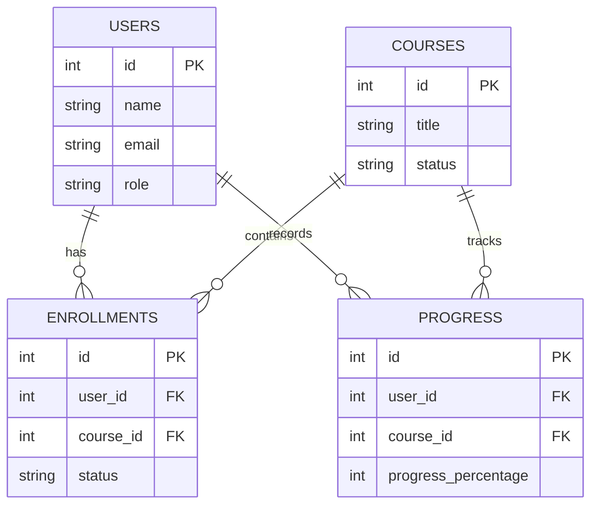

# PHASE_3_DATABASE_API_DESIGN.md

**Project:** EduAdmin  
**Phase:** 3 — Database and API Design (design and verification only)  
**Date:** 2026-10-19  

**Labels used in this document**

| Label | Meaning |
|-------|---------|
| **Verified** | Confirmed from current source or schema |
| **Proposed** | Recommended change not yet applied |
| **Unverified** | Insufficient evidence |
| **Not required** | Already supported or out of scope |

**Scope note:** EduAdmin is a **standalone** administration application (React + Express + MySQL). There is no separate LMS repository in this workspace. “Existing platform” in this report means **this repository’s** backend, schema, and APIs.

**This phase did not:** modify application code, alter tables, run migrations, install packages, or expose secrets.

---

## 1. Existing database and backend architecture

### Stack (**Verified**)

| Layer | Technology | Evidence |
|-------|------------|----------|
| Database | MySQL 8.4 (InnoDB, `utf8mb4`) | `docker-compose.yml`, `backend/db/schema.sql` |
| Access | `mysql2` connection pool | `backend/src/db/pool.js` |
| ORM | None (SQL in services) | `backend/src/services/*` |
| API | Express, Zod validation, Helmet, CORS, rate limit on login | `backend/src/app.js`, `validators/schemas.js` |
| Auth | JWT Bearer + `session_version` | `middleware/auth.js`, `authService.js` |
| Schema apply | Destructive local seed (`DROP` + recreate) | `backend/db/schema.sql`, `db/seed.js` |
| API prefix | `/api/v1` (+ `/api/health`) | `backend/src/routes/index.js` |

### Backend organization (**Verified**)

```
backend/src/
  index.js          → listen
  app.js            → Express app
  routes/index.js   → route registration
  middleware/       → auth, validate, errors
  services/         → domain logic + SQL
  validators/       → Zod schemas
  db/pool.js
  lib/              → sql helpers, activity, errors
backend/db/
  schema.sql
  seed.js
backend/tests/
  api.test.js       → Node test runner integration tests
```

### Frontend consumption (**Verified**)

- `frontend/src/api/client.js` — `fetch` + `Authorization: Bearer`, Vite proxy `/api` → `:4000`
- Pages call `/api/v1/...` directly
- Language is **JavaScript** (no TypeScript in frontend)

---

## 2. Verified tables, models, and relationships

Source of truth: `backend/db/schema.sql`.

### Entity inventory

#### `users` — **Verified**

| Aspect | Detail |
|--------|--------|
| Purpose | All accounts: students and administrators |
| PK | `id` INT UNSIGNED AI |
| Important fields | `name`, `email` (UNIQUE), `password_hash`, `role`, `status`, `session_version`, timestamps |
| Roles | `super_admin`, `admin`, `student` |
| Status | `active`, `inactive`, `suspended` |
| Indexes | `uq_users_email`, `idx_users_role_status (role, status)` |
| Student model | **No separate students table** — students are `users` with `role = 'student'` |

#### `categories` — **Verified**

| Aspect | Detail |
|--------|--------|
| Purpose | Course categories |
| PK | `id` |
| Fields | `name` UNIQUE, `description` NULL |

#### `courses` — **Verified**

| Aspect | Detail |
|--------|--------|
| Purpose | Course catalog |
| PK | `id` |
| Fields | `title`, `description`, `category_id`, `status` (`draft`/`published`), `created_by`, timestamps |
| FKs | `category_id` → `categories`; `created_by` → `users` ON DELETE SET NULL |
| Indexes | `idx_courses_status`, `idx_courses_category` |

#### `enrollments` — **Verified**

| Aspect | Detail |
|--------|--------|
| Purpose | Student ↔ course relationship |
| PK | `id` |
| Fields | `user_id`, `course_id`, `status` (`active`/`completed`/`withdrawn`), `enrolled_at` |
| Unique | `uq_enrollment (user_id, course_id)` — prevents duplicate pairs |
| FKs | CASCADE on user/course delete |
| Indexes | course, status, enrolled_at |

#### `progress` — **Verified**

| Aspect | Detail |
|--------|--------|
| Purpose | Per student–course learning progress |
| PK | `id` |
| Fields | `user_id`, `course_id`, `percent` (0–100 CHECK), `status`, `updated_at` |
| Unique | `uq_progress (user_id, course_id)` |
| FKs | CASCADE on user/course delete |

#### `activity_logs` — **Verified**

| Aspect | Detail |
|--------|--------|
| Purpose | Administrative activity for dashboard |
| PK | `id` |
| Fields | `actor_id`, `action`, `entity_type`, `entity_id`, `details`, `created_at` |
| FK | `actor_id` → `users` ON DELETE SET NULL |
| Index | `idx_activity_created` |

### Approved conceptual ERD (owner-provided)

This is the **approved core database design**. Relationships match crow’s-foot 1:N as in the supplied diagram.



### Mapping: conceptual ERD → live MySQL (**Verified**)

| Conceptual | Live table / column | Notes |
|------------|---------------------|-------|
| USERS | `users` | Also has `password_hash`, `status`, `session_version`, timestamps for auth |
| COURSES | `courses` | Also has `description`, `category_id`, `created_by`, timestamps |
| ENROLLMENTS | `enrollments` | Also has `enrolled_at`; UNIQUE `(user_id, course_id)` |
| PROGRESS.`progress_percentage` | `progress.percent` | Same meaning; CHECK ≤ 100; also `status`, `updated_at` |

Supporting tables beyond the core ERD (**Verified**, keep for product features):

- `categories` — course grouping in admin UI  
- `activity_logs` — dashboard recent activity  

### Cardinalities (**Verified** / matches diagram)

- USERS **has** many ENROLLMENTS; COURSES **contains** many ENROLLMENTS  
- USERS **records** many PROGRESS; COURSES **tracks** many PROGRESS  
- At most one enrollment and one progress row per `(user_id, course_id)`
---

## 3. Database gaps and proposed changes

| Item | Status | Notes |
|------|--------|-------|
| Core EduAdmin tables | **Not required** (already present) | Supports students, courses, enrollments, progress, activity, reports |
| Separate `students` table | **Not required** | Role discriminator on `users` |
| Soft archival vs hard FK CASCADE | **Verified** app behavior + **Proposed** schema note | App soft-withdraws enrollments and soft-unpublishes courses; schema still has `ON DELETE CASCADE` if a user/course row is hard-deleted |
| Versioned migrations | **Proposed** | Replace reliance on destructive `schema.sql` DROP for any non-local environment |
| CSV export storage | **Not required** | Export would be generated from queries, not stored |
| Password change fields | **Not required** for current APIs | Profile updates name only |
| Lessons / quizzes | **Not required** | Out of Phase 2 scope |

### Soft-delete / archival policy (**Verified** in application code)

| Resource | HTTP DELETE behavior | Physical row |
|----------|----------------------|--------------|
| Enrollment | Sets status `withdrawn` | Kept |
| Course | Sets status `draft` | Kept |
| Student | No DELETE endpoint | Status `inactive` / `suspended` via PATCH |

### Integrity recommendations (**Proposed** — optional hardening)

1. Prefer Restrict/SET NULL over CASCADE for production deletes if hard delete is ever introduced.  
2. Add composite index `(user_id, status)` on enrollments if filtering by student+status becomes hot (**Unverified** load).  
3. Move from “drop all + seed” to additive migration files before any shared/staging deploy.

---

## 4. API endpoint specification

Base path: **`/api/v1`** (**Verified**).

Unless noted, endpoints require `Authorization: Bearer <jwt>` and an active `admin` or `super_admin`.

| Method | Path | Purpose | Permissions | Exists? |
|--------|------|---------|-------------|---------|
| GET | `/api/health`, `/api/v1/health` | Liveness | Public | **Verified** |
| POST | `/api/v1/auth/login` | Sign in | Public + rate limit | **Verified** |
| GET | `/api/v1/auth/me` | Current user | Auth | **Verified** |
| PATCH | `/api/v1/auth/me` | Update own name | Auth | **Verified** |
| POST | `/api/v1/auth/logout` | Invalidate JWT via `session_version` | Auth | **Verified** |
| GET | `/api/v1/dashboard` | KPIs, trend, activity, attention | Auth | **Verified** |
| GET | `/api/v1/students` | Paginated student list | Auth | **Verified** |
| GET | `/api/v1/students/:id` | Student detail | Auth | **Verified** |
| PATCH | `/api/v1/students/:id` | Update name/email/status | Auth | **Verified** |
| POST | `/api/v1/students` | Create student | — | **Not required** (no create in current product) |
| DELETE | `/api/v1/students/:id` | Hard delete | — | **Not required** (use status) |
| GET | `/api/v1/courses` | Course list | Auth | **Verified** |
| POST | `/api/v1/courses` | Create course | Auth | **Verified** |
| PATCH | `/api/v1/courses/:id` | Update / publish | Auth | **Verified** |
| DELETE | `/api/v1/courses/:id` | Soft unpublish → draft | Auth | **Verified** |
| GET | `/api/v1/enrollments` | Enrollment list | Auth | **Verified** |
| POST | `/api/v1/enrollments` | Enroll (txn + progress upsert) | Auth | **Verified** |
| PATCH | `/api/v1/enrollments/:id` | Change status | Auth | **Verified** |
| DELETE | `/api/v1/enrollments/:id` | Soft withdraw | Auth | **Verified** |
| GET | `/api/v1/progress` | Progress list | Auth | **Verified** |
| GET | `/api/v1/reports` | Summary report | Auth | **Verified** |
| GET/POST/PATCH | `/api/v1/administrators` | Admin management | `super_admin` only | **Verified** |
| GET | `/api/v1/lookups` | Categories + enum helpers | Auth | **Verified** |
| GET | `/api/v1/reports/export` | CSV | — | **Proposed** only if product requires CSV |

### Query / body contracts (**Verified** via Zod)

| Endpoint | Query / body highlights |
|----------|-------------------------|
| Students list | `q`, `status`, `page` (≥1), `limit` (1–50) |
| Courses list | `q`, `status`, `categoryId`, `page`, `limit` |
| Course create | `title`, `description`, `categoryId`, `status` |
| Enrollments list | `q`, `status`, `courseId`, `page`, `limit` |
| Enrollment create | `userId`, `courseId` — student must be active; course must be **published** |
| Progress list | `q`, `status`, `courseId`, `page`, `limit` |
| Reports | `from`, `to` as `YYYY-MM-DD` optional; `from ≤ to` |

### Status codes (**Verified**)

| Code | When |
|------|------|
| 200 | Success with JSON body |
| 201 | Created (course, enrollment, admin) |
| 204 | Logout; soft DELETE courses/enrollments |
| 400 | Validation / business rule (unpublished course, inactive student) |
| 401 | Missing/invalid/expired token |
| 403 | Student login; wrong role (e.g. admin → administrators) |
| 404 | Missing student/course/enrollment |
| 409 | Duplicate enrollment (non-withdrawn) |
| 429 | Login rate limit |
| 500 | Unexpected (generic message only) |

Error shape (**Verified**): `{ "message": "...", "errors"?: { field: "..." } | [...] }` via `AppError` + Zod middleware.

---

## 5. Request and response examples

### Login — **Verified** shape

```http
POST /api/v1/auth/login
Content-Type: application/json

{ "email": "registrar@eduadmin.test", "password": "***" }
```

```json
{
  "token": "<jwt>",
  "user": {
    "id": 2,
    "name": "...",
    "email": "registrar@eduadmin.test",
    "role": "admin",
    "status": "active"
  }
}
```

`password_hash` is never returned (**Verified**).

### Paginated list — **Verified** (`toPage` in `lib/sql.js`)

```json
{
  "data": [ { "id": 1, "name": "...", "email": "...", "status": "active", "createdAt": "...", "enrollmentCount": 2 } ],
  "meta": {
    "page": 1,
    "limit": 10,
    "total": 18,
    "totalPages": 2
  }
}
```

Empty search → **200** with `data: []` and `meta.total: 0` (**Verified** convention).

### Dashboard — **Verified**

```json
{
  "data": {
    "students": 18,
    "courses": 9,
    "publishedCourses": 7,
    "draftCourses": 2,
    "enrollments": 31,
    "averageProgress": 45,
    "enrollmentTrend": [ { "month": "2026-05", "count": 0 } ],
    "recentActivity": [ { "id": 1, "action": "enrollment.created", "details": "...", "createdAt": "...", "actorName": "..." } ],
    "attention": [ { "studentName": "...", "courseTitle": "...", "percent": 5 } ]
  }
}
```

---

## 6. Dashboard statistics calculation rules

All definitions from `dashboardService.js` / `reportService.js` — **Verified**.

| Metric | Definition | Source | Notes |
|--------|------------|--------|-------|
| `students` | `COUNT(*)` where `role = 'student'` | `users` | Includes inactive/suspended |
| `courses` | `COUNT(*)` all courses | `courses` | Draft + published |
| `publishedCourses` / `draftCourses` | Filtered by `status` | `courses` | |
| `enrollments` | Count where `status <> 'withdrawn'` | `enrollments` | Withdrawn excluded |
| `averageProgress` | `ROUND(AVG(percent))` for progress joined to non-withdrawn enrollments | `progress` ⋈ `enrollments` | `NULL` → `0` |
| `enrollmentTrend` | Counts by `DATE_FORMAT(enrolled_at,'%Y-%m')` last 6 calendar months | `enrollments` | Missing months filled with `0` |
| `recentActivity` | Latest 8 activity rows | `activity_logs` | |
| `attention` | Active enrollments with `percent < 40`, top 5 | progress + enrollments | |
| Report `completionRate` | `completed / non-withdrawn enrollments` in date window | report query | 0 if no enrollments |

**Not hardcoded** in the UI: totals come from these aggregates (**Verified** by design and API tests).

---

## 7. Authentication and authorization requirements

### Mechanism (**Verified**)

1. Login issues JWT `{ sub: userId, sv: session_version }` signed with `JWT_SECRET`.  
2. `authenticate` verifies JWT, loads user via `getSessionUser` (must be active admin/super_admin), checks `sv` matches DB.  
3. Logout increments `session_version` → prior tokens fail.  
4. `authorize('super_admin')` gates `/administrators`.  
5. Student login rejected at login with **403** (not a token grant).

### Endpoint matrix (**Verified**)

| Capability | AuthN | AuthZ |
|------------|-------|-------|
| Health, login | No | Public |
| All other `/api/v1/*` | Bearer JWT | `admin` or `super_admin` |
| Administrators CRUD-ish | Bearer JWT | `super_admin` only |

### Security rules (**Verified** / must keep)

- Never accept role from client body for privilege.  
- Never return `password_hash` or raw tokens in list payloads.  
- Parameterized SQL only (`?` placeholders).  
- Backend Zod validation is authoritative; frontend validation is UX only.

---

## 8. Frontend integration contract

### Client (**Verified**)

- Module: `frontend/src/api/client.js`  
- Token key: `eduadmin.token` in `localStorage`  
- On **401** (except login): clear session via `setUnauthorizedHandler`  
- Proxy: Vite `server.proxy['/api']` → `http://127.0.0.1:4000`

### Conceptual types (JSDoc-style — **Proposed** documentation aid; frontend is JS)

```ts
// Illustrative — not a TS project today
type Role = 'super_admin' | 'admin' | 'student';
type UserStatus = 'active' | 'inactive' | 'suspended';

interface AuthUser {
  id: number;
  name: string;
  email: string;
  role: Role;
  status: UserStatus;
}

interface PageMeta {
  page: number;
  limit: number;
  total: number;
  totalPages: number;
}

interface Paginated<T> {
  data: T[];
  meta: PageMeta;
}
```

### UI state patterns (**Verified**)

| State | Pattern |
|-------|---------|
| Loading | Skeletons via `DataPanel` / page skeletons |
| Empty | Copy inside panels when `data.length === 0` |
| Error | Message + retry (`useResource`) |
| Validation | Field errors from `error.errors` + toasts |
| Success | Toast after mutations |

### Soft-action UX (**Verified**)

- Course DELETE labeled **Unpublish** in UI  
- Enrollment DELETE labeled **Withdraw** in UI  

---

## 9. Migration and data-safety plan

### Current local workflow (**Verified**)

`npm run db:seed` runs `schema.sql` which **DROPs** all EduAdmin tables then recreates and seeds. Suitable for **local demo only**.

### Proposed production-safe approach (**Proposed** — do not run in Phase 3)

| Step | Action | Compatibility |
|------|--------|---------------|
| 1 | Treat current `schema.sql` as baseline v1 | N/A |
| 2 | Introduce numbered migrations (`001_init.sql` already applied locally) | Forward-only |
| 3 | Never DROP in shared environments | Preserve data |
| 4 | Back up before migrate | Recovery |
| 5 | Smoke: `npm test` + login + dashboard | Verify |
| 6 | Rollback = restore backup (no automated down migrations yet) | Manual |

### Proposed schema changes for Phase 4+ (**Proposed**, optional)

| Change | Why | Backward compatible? |
|--------|-----|----------------------|
| Replace CASCADE with RESTRICT on enrollments/progress if hard deletes are forbidden | Align DB with soft-delete policy | Yes if app never hard-deletes |
| Additive indexes only after EXPLAIN | Performance | Yes |

**Do not** drop tables or wipe data outside controlled local seed.

---

## 10. Testing plan

### Existing coverage (**Verified**)

`backend/tests/api.test.js` (Node `--test`), run via `npm test`:

- Invalid login → 401  
- Student login → 403  
- Admin login → token  
- Dashboard requires auth; returns numeric totals  
- Admin cannot list administrators → 403  
- Super admin can list administrators  
- Duplicate enrollment → 409  
- DELETE enrollment → withdrawn row remains  
- DELETE course → draft row remains  

### Recommended additional tests (**Proposed**)

| Area | Cases |
|------|-------|
| Students | PATCH status; 404 non-student id; list pagination meta |
| Courses | Create validation; publish/unpublish PATCH |
| Enrollments | Reject unpublished course; reject inactive student; transaction creates progress |
| Reports | `from > to` → 400; date filter affects enrollments |
| Auth | Logout invalidates token (`session_version`) |
| Regression | Health endpoint; lookups |

### Data safety

- Use local Docker MySQL / re-seed for tests.  
- Never point tests at production.  
- Current tests mutate local seed data (withdraw/unpublish); re-seed before demos: `npm run db:seed`.

---

## 11. Risks, assumptions, and unresolved questions

### Risks

| Risk | Label | Mitigation |
|------|-------|------------|
| Destructive seed in wrong environment | **Verified** capability | Document; gate seed; add non-destructive migrations |
| JWT in `localStorage` XSS risk | **Verified** pattern | Keep CSP/Helmet; consider HttpOnly cookies later |
| CASCADE hard-delete vs soft-delete story | **Verified** mismatch potential | Keep soft ops in API; avoid hard DELETE SQL |
| No Git repository | **Verified** | Init when owner approves |
| Enrollment trend includes withdrawn months in SQL filter window but KPI excludes withdrawn | **Verified** nuance | Document; adjust only if product wants consistency |

### Assumptions

- Standalone EduAdmin DB is the system of record (no external LMS sync).  
- Soft archive is the approved lifecycle for courses/enrollments.  
- `/api/v1` remains the public contract.

### Unresolved questions (need owner approval)

1. Freeze soft-delete policy as permanent for v1?  
2. Is CSV export required (**Proposed** endpoint only if yes)?  
3. Should student **create** be added, or remain seed/admin-only?  
4. Should progress be admin-editable via API?  
5. Approve replacing DROP-seed with versioned migrations before any shared deploy?  
6. Initialize Git and choose remote hosting?

---

## 12. Recommended implementation order for Phase 4

Phase 4 should focus on **hardening and operational readiness**, not rebuilding features that already exist.

1. **Confirm** unresolved decisions in §11 (especially soft-delete + migrations + CSV).  
2. **Introduce** non-destructive migration workflow (**Proposed**) while keeping local seed for demos.  
3. **Expand** API tests (logout invalidation, unpublished enrollment rejection, report date validation).  
4. **Optional:** CSV export endpoint + UI if approved.  
5. **Optional:** align FK ON DELETE with soft-delete policy.  
6. **Ops:** Git init, environment templates (no secrets in repo), deployment notes.  
7. **Do not** add a second auth system or parallel database.

### What Phase 4 should **not** redo

- New students/courses/enrollments/progress/activity tables — **Not required**  
- Duplicate REST resources under different paths — **Not required**  
- Rebuild React pages already present — **Not required** unless bugs found  

---

## Summary for approval

### Most important findings

1. **Verified:** Full MySQL schema and `/api/v1` surface already implement Phase 2 EduAdmin requirements.  
2. **Verified:** Students live in `users`; enrollments and progress have uniqueness and FKs; dashboard/report metrics are SQL aggregates.  
3. **Verified:** Soft withdraw / soft unpublish are application policy; API tests cover authz and those behaviors.  
4. **Proposed:** Safer migrations for non-local use; optional CSV; optional FK tightening.  

### Decisions needed from you

- Soft-delete freeze, CSV, student create, admin-editable progress, migration strategy, Git.

### Readiness

**Ready for Phase 4 with blockers** — design is implementation-ready because the DB/API already exist and are documented; Phase 4 should harden and extend only after you confirm the open product/ops questions above.

**Phase 3 complete:** this report only; no schema or application code was changed in this phase.
